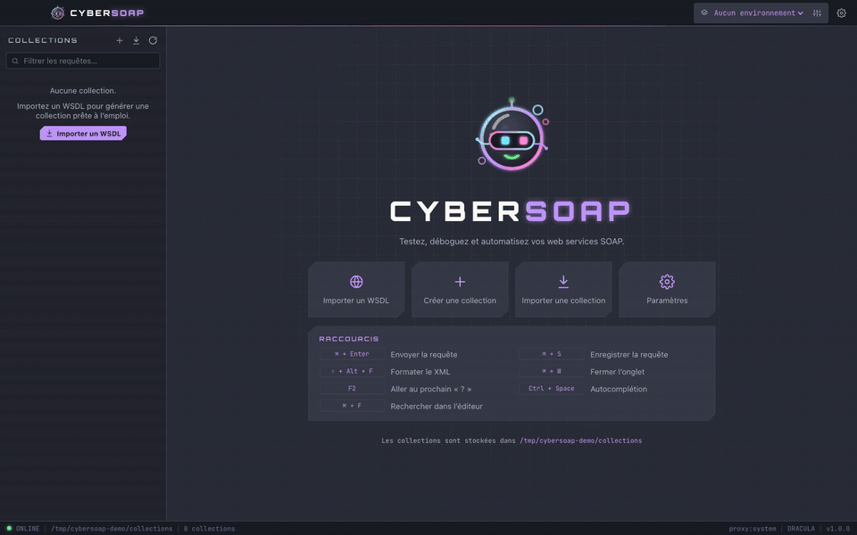
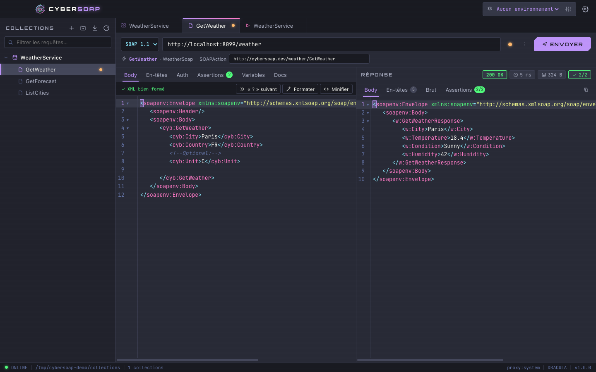
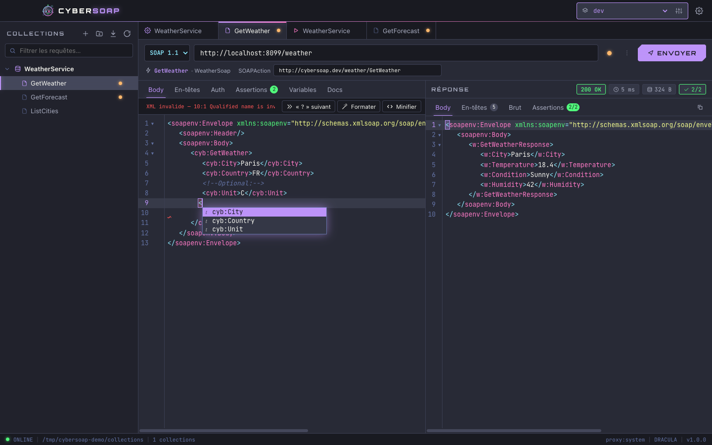
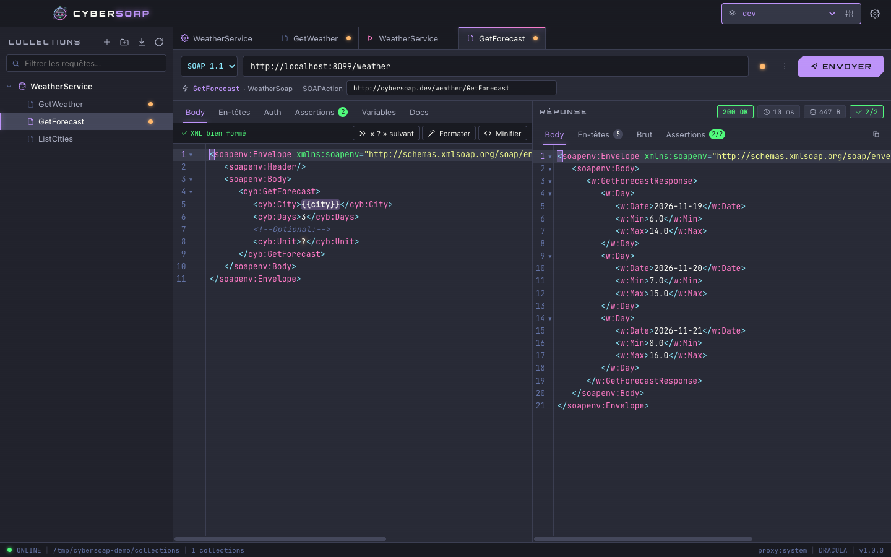
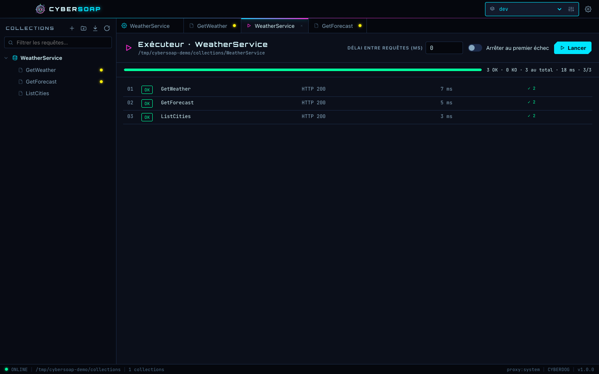
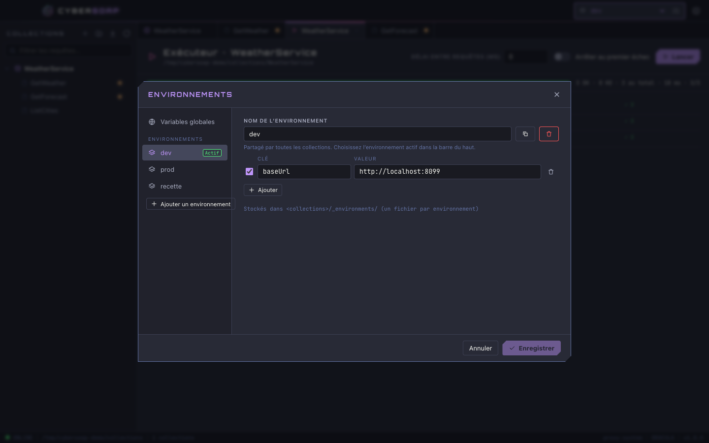
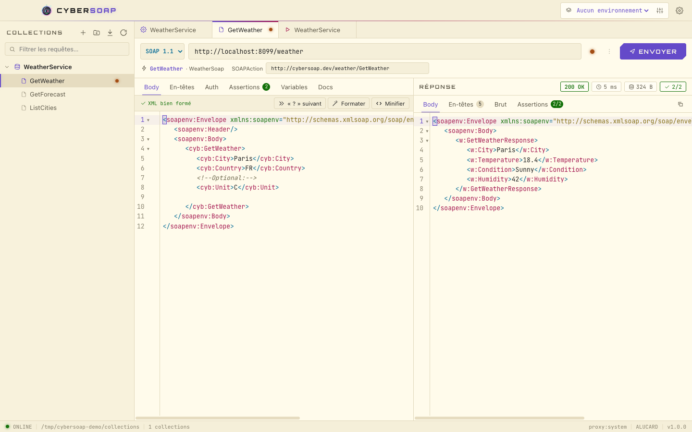
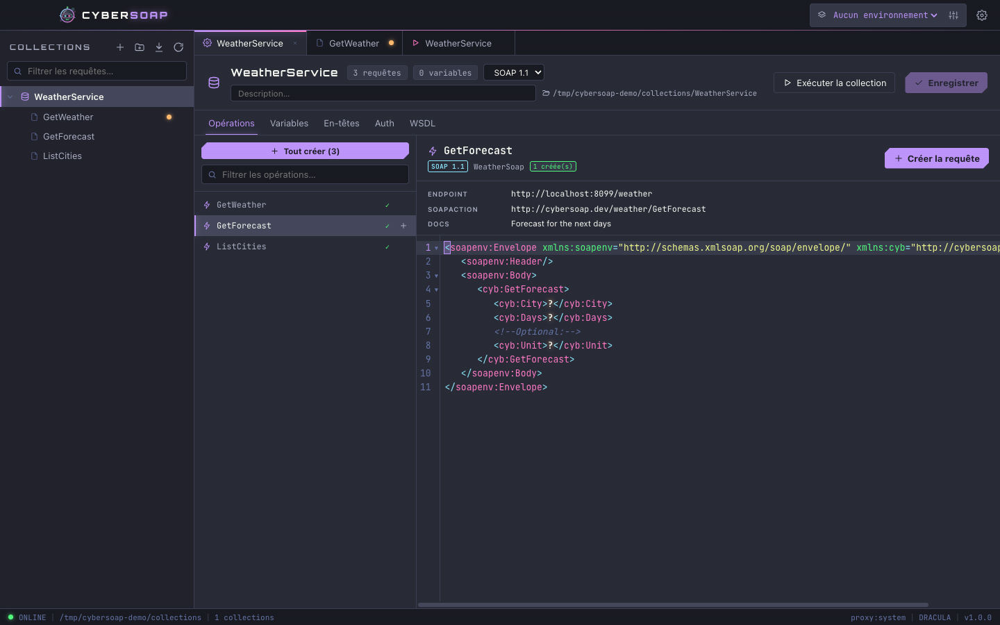

<p align="center">
  
</p>

<h1 align="center">CYBERSOAP</h1>

<p align="center">
  Client desktop open source pour tester, déboguer et automatiser vos web services SOAP.<br/>
  Importez un WSDL, choisissez les opérations : chaque requête est prête à lancer.
</p>

<p align="center">
  <a href="https://github.com/pickywawa/cybersoap/releases/latest"></a>
  <a href="https://github.com/pickywawa/cybersoap/releases"></a>
  <a href="https://pickywawa.github.io/cybersoap/"></a>
  
  
</p>

<p align="center">
  <b><a href="https://pickywawa.github.io/cybersoap/">⬇ Télécharger</a></b> ·
  <a href="https://github.com/pickywawa/cybersoap/releases">Toutes les versions</a> ·
  <a href="https://github.com/pickywawa/cybersoap/issues">Signaler un bug</a>
</p>



## Sommaire

- [Pourquoi CyberSoap ?](#pourquoi-cybersoap-)
- [Fonctionnalités](#fonctionnalités)
- [Installation](#installation)
- [Prise en main](#prise-en-main)
- [Guide](#guide)
  - [Import WSDL](#import-wsdl)
  - [Éditeur XML](#éditeur-xml)
  - [Variables et environnements](#variables-et-environnements)
  - [Authentification](#authentification)
  - [Assertions](#assertions)
  - [Extraction de valeurs (property transfer)](#extraction-de-valeurs-property-transfer)
  - [Runner](#runner)
  - [Organisation des requêtes](#organisation-des-requêtes)
  - [Import / export](#import--export)
- [Stockage sur disque](#stockage-sur-disque)
- [Paramètres](#paramètres)
- [Réseau et proxy](#réseau-et-proxy)
- [Mises à jour](#mises-à-jour)
- [Raccourcis clavier](#raccourcis-clavier)
- [Dépannage](#dépannage)
- [Développement](#développement)
- [Licence](#licence)

## Pourquoi CyberSoap ?

SoapUI est puissant mais lourd ; les clients REST modernes gèrent mal SOAP. CyberSoap prend les fonctionnalités utiles de SoapUI (génération depuis le WSDL, assertions, property transfer, runner) dans une interface légère inspirée de Bruno, avec un stockage en fichiers que vous pouvez versionner avec Git.

## Fonctionnalités

| | |
|---|---|
| ⚡ **Import WSDL** | WSDL 1.1, SOAP 1.1 / 1.2, document/literal et rpc, `xsd:import` / `include`, types récursifs. Enveloppes générées façon SoapUI. |
| ⌨ **Vrai éditeur XML** | Coloration, autocomplétion issue du schéma (éléments, attributs, valeurs d'énumération), lint en direct, pliage, recherche, formatage. |
| 🗂 **Onglets** | Plusieurs requêtes ouvertes, réponse à droite, séparateur redimensionnable, onglets réorganisables. |
| ✔ **Assertions** | SOAP Fault, statut HTTP, contient, regex, XPath, temps de réponse, XML valide. |
| 🔗 **Property transfer** | Extraction XPath vers des variables réutilisables dans les requêtes suivantes. |
| ▶ **Runner** | Exécution d'une collection ou d'un dossier avec bilan. |
| 🌐 **Environnements globaux** | Variables globales et environnements partagés par toutes les collections. |
| 🔐 **Auth** | Basic, Bearer, WS-Security UsernameToken (Text / Digest + Timestamp). |
| 📁 **Fichiers, pas de BDD** | 1 collection = 1 dossier, 1 requête = 1 fichier JSON. |
| 🔄 **Mises à jour auto** | Depuis GitHub Releases. |
| 🎨 **Thèmes & langues** | 10 thèmes : Dracula (défaut), Cyberdog Neon, Synthwave 84, Matrix, Nord Ice en sombre ; Daylight, Alucard, Solar Flare, Frost Byte, Sakura Neon en clair · Français / English. |

| Requête & réponse | Autocomplétion | Variables & environnement actif |
|---|---|---|
|  |  |  |
| **Runner (thème Cyberdog Neon)** | **Environnements globaux** | **Thème clair (Alucard)** |
|  |  |  |

## Installation

Téléchargez la dernière version depuis la [page du projet](https://pickywawa.github.io/cybersoap/) ou les [releases](https://github.com/pickywawa/cybersoap/releases/latest).

| Système | Fichier |
|---|---|
| macOS Apple Silicon (M1…) | `CyberSoap-x.y.z-mac-arm64.dmg` |
| macOS Intel | `CyberSoap-x.y.z-mac-x64.dmg` |
| Windows 10/11 x64 | `CyberSoap-x.y.z-win-x64.exe` |
| Linux x64 | `CyberSoap-x.y.z-linux-x86_64.AppImage` |

> ⚠️ Les builds **ne sont pas signés**, votre système vous avertira au premier lancement.

**macOS** — glissez l'app dans Applications. Si macOS indique qu'elle est « endommagée » ou « ne peut pas être ouverte » :

```bash
xattr -cr /Applications/CyberSoap.app
```

**Windows** — à l'avertissement SmartScreen : « Informations complémentaires » → « Exécuter quand même ».

**Linux** :

```bash
chmod +x CyberSoap-*.AppImage
./CyberSoap-*.AppImage
```

Sur certaines distributions, les AppImage nécessitent `libfuse2` (`sudo apt install libfuse2`).

## Prise en main

1. Cliquez sur **Importer un WSDL** (écran d'accueil, ou icône ⬇ en haut de la liste des collections).
2. Collez l'URL du WSDL (ex. `https://hote/service?wsdl`) ou choisissez un fichier, puis **Analyser** pour voir les opérations.
3. **Créer la collection** : la page de la collection s'ouvre sur la liste des **opérations** du WSDL. Aucune requête n'est encore créée.
4. Cliquez sur une opération pour voir son détail, puis **Créer la requête** (ou **Tout créer**). La requête s'ouvre avec l'URL du endpoint, le SOAPAction et l'enveloppe générée.
5. Remplacez les `?` par vos valeurs (<kbd>F2</kbd> saute au suivant), puis **Envoyer** (<kbd>⌘/Ctrl</kbd> + <kbd>Entrée</kbd>).
6. La réponse s'affiche à droite avec le statut, le temps, la taille et le résultat des assertions.

## Guide

### Import WSDL

- Sources : URL `http(s)://…`, chemin de fichier local ou `file://`. Les `wsdl:import`, `xsd:import`, `xsd:include` et `xsd:redefine` sont suivis (chemins relatifs résolus).
- WSDL protégé : dépliez « Identifiants optionnels » pour fournir un login / mot de passe Basic.
- L'import crée la collection et enregistre la **liste des opérations** disponibles (`operations.json`), sans créer de requête.
- Enveloppes : les éléments optionnels sont précédés de `<!--Optional:-->`, les répétitions de `<!--Zero or more repetitions:-->`, les `choice` d'un commentaire explicatif. Les valeurs sont des `?` à remplacer.
- **Mettre à jour depuis le WSDL** (clic droit sur la collection, ou onglet WSDL de la collection) : relit le WSDL, rafraîchit la liste des opérations et l'autocomplétion, sans toucher à vos requêtes existantes.

### Opérations et création des requêtes

Cliquer sur une collection ouvre sa page : en haut, un en-tête compact (nom, nombre de requêtes et de variables, version SOAP, description, emplacement) ; en dessous, l'onglet **Opérations**.



- **À gauche**, la liste des opérations proposées par le WSDL (regroupées par interface quand il y en a plusieurs), avec un filtre. Une coche ✓ indique combien de requêtes ont déjà été créées depuis l'opération.
- **À droite**, le détail de l'opération sélectionnée : endpoint, SOAPAction, documentation et enveloppe générée.
- **Créer la requête** (bouton du détail, ou ⊕ au survol d'une ligne) : crée le fichier et l'ouvre directement, prêt à être envoyé.
- **Tout créer** : crée une requête par opération (ou seulement celles qui correspondent au filtre).
- Une opération peut être créée autant de fois que nécessaire, à tout moment : si le nom existe déjà, il est numéroté (`GetWeather (2)`).
- Les nouvelles requêtes sont ajoutées **à la fin** de la collection, sans tri automatique.
- Chaque requête créée contient deux assertions par défaut : **pas de SOAP Fault** et **statut HTTP 200**.
- Le runner n'exécute que les requêtes créées, pas les opérations disponibles.
- Non supporté : WSDL 2.0, MTOM / pièces jointes.

### Éditeur XML

| Fonction | Détail |
|---|---|
| Autocomplétion | Tapez `<` : seuls les enfants valides de l'élément courant sont proposés. Dans un élément énuméré, les valeurs possibles sont proposées. <kbd>Ctrl</kbd> + <kbd>Espace</kbd> pour forcer. |
| Variables | Tapez `{{` pour compléter les variables disponibles. Elles sont surlignées dans l'éditeur. |
| Validation | Le XML est vérifié en continu ; l'erreur (ligne:colonne) s'affiche dans la barre au-dessus de l'éditeur. |
| Placeholders | Les `?` sont mis en évidence ; <kbd>F2</kbd> ou **« ? » suivant** sélectionne le prochain. |
| Formatage | **Formater** (<kbd>⇧</kbd> + <kbd>Alt</kbd> + <kbd>F</kbd>) et **Minifier**. |
| Édition | Pliage, recherche / remplacement (<kbd>⌘/Ctrl</kbd> + <kbd>F</kbd>), multi-curseurs, fermeture automatique des balises. |

L'onglet **En-têtes** permet d'ajouter des en-têtes HTTP. `Content-Type` et `SOAPAction` sont ajoutés automatiquement selon la version SOAP (1.1 : `text/xml` + `SOAPAction` ; 1.2 : `application/soap+xml;action=…`).

Le menu **⋮** à côté de l'URL permet de **copier la requête en cURL**, de l'exporter ou de l'afficher dans le Finder / l'Explorateur.

### Variables et environnements

Les variables s'utilisent avec la syntaxe `{{nom}}` dans l'URL, le SOAPAction, les en-têtes, l'authentification, le body et les valeurs d'assertion.

| Niveau | Où les définir | Portée |
|---|---|---|
| Globales | icône à droite du sélecteur d'environnement (barre du haut) → **Variables globales** | toutes les collections |
| Collection | Paramètres de la collection → **Variables** | la collection |
| Environnement | même fenêtre → un environnement (`dev`, `recette`, `prod`…) | toutes les collections, quand il est actif |
| Exécution | extraites des réponses (voir plus bas) | la collection, jusqu'à la fermeture de l'app |

Priorité, de la plus faible à la plus forte : **globales < collection < environnement actif < valeurs extraites**.

L'environnement actif se choisit dans la barre du haut. Une variable non résolue est signalée en orange sous l'URL.

Variables dynamiques :

| Variable | Exemple |
|---|---|
| `{{$uuid}}` / `{{$guid}}` | `3f2b…-…` |
| `{{$timestamp}}` | `1795080000` (secondes) |
| `{{$timestampMs}}` | `1795080000123` |
| `{{$isoTimestamp}}` | `2026-11-19T10:00:00.000Z` |
| `{{$date}}` | `2026-11-19` |
| `{{$randomInt}}` | `0` à `999` |
| `{{$randomString}}` | `k3j9x0aa` |

Exemple : environnement `recette` avec `baseUrl = http://10.0.0.12:8080`, puis l'URL de la requête `{{baseUrl}}/MonService`.

### Authentification

Onglet **Auth** d'une requête, ou des paramètres de la collection (les requêtes en « Hériter de la collection » l'utilisent).

| Type | Effet |
|---|---|
| Basic | en-tête `Authorization: Basic …` |
| Bearer | en-tête `Authorization: Bearer …` |
| WS-Security UsernameToken | insère `wsse:Security` dans le `Header` SOAP : `PasswordText` ou `PasswordDigest` (nonce + date), `mustUnderstand`, `Timestamp` optionnel (TTL en secondes) |

### Assertions

Onglet **Assertions** d'une requête. Le résultat apparaît après chaque envoi (onglet Assertions de la réponse et pastille ✓ x/y).

| Assertion | Valeur | Réussit si… |
|---|---|---|
| Pas de SOAP Fault | — | la réponse ne contient pas de `Fault` |
| SOAP Fault | — | la réponse contient un `Fault` (tests négatifs) |
| Statut HTTP | `200` ou `200,201` | le statut fait partie de la liste |
| Contient / Ne contient pas | texte | le body contient (ou non) le texte |
| Regex | expression régulière | le body correspond |
| XPath | expression + valeur attendue optionnelle | le nœud existe, ou sa valeur est égale à l'attendu |
| Temps de réponse ≤ | millisecondes | la réponse arrive à temps |
| XML valide | — | le body est du XML bien formé |

XPath : les préfixes déclarés dans la réponse sont utilisables (`//tem:AddResult`). Sinon, `//*[local-name()='AddResult']` fonctionne toujours. Les valeurs peuvent contenir des `{{variables}}`.

### Extraction de valeurs (property transfer)

Onglet **Variables** d'une requête : associez un nom de variable à une expression XPath. Après chaque appel réussi, la valeur trouvée est stockée comme variable d'exécution de la collection.

Exemple : la requête `Login` extrait `session` avec `//*[local-name()='SessionId']`, puis les requêtes suivantes utilisent `{{session}}`. Les valeurs courantes sont visibles dans ce même onglet et peuvent être vidées.

### Runner

Clic droit sur une collection ou un dossier → **Exécuter**, ou bouton **Exécuter la collection** dans ses paramètres.

- Les requêtes sont jouées dans l'ordre de l'arborescence, avec leurs assertions et extractions (enchaînement possible via les variables).
- Options : délai entre requêtes, arrêt au premier échec.
- Une requête échoue si l'appel échoue, si une assertion échoue, ou (sans assertion) si le statut HTTP est ≥ 400.
- Cliquez sur une ligne pour ouvrir la requête et sa réponse.

### Organiser les collections en dossiers

Les collections peuvent être rangées dans des dossiers (facultatif), eux-mêmes imbriquables : par équipe, par client, par projet…

- **Créer un dossier** : bouton dossier ⊕ en haut de la liste des collections, ou clic droit sur un dossier → **Nouveau dossier**.
- **Créer une collection dans un dossier** : clic droit sur le dossier → **Nouvelle collection**.
- **Déplacer** : glissez une collection ou un dossier sur un dossier ; sur une collection pour le placer à côté ; sur la zone vide de la liste pour le remettre à la racine. Ou clic droit → **Déplacer vers…**.
- **Replier / déplier** : clic sur le dossier (ouvert par défaut).
- Les onglets ouverts suivent le déplacement. Une collection ou un dossier ne peut pas être placé dans une collection.

### Organisation des requêtes

- Les requêtes sont **triées par ordre alphabétique** par défaut (tri naturel : `Test 2` avant `Test 10`), les dossiers en premier.
- **Glisser-déposer** : en haut ou en bas d'une ligne pour placer avant / après, au milieu d'un dossier pour déplacer dedans. L'ordre manuel est enregistré dans `collection.json` / `folder.json`.
- Clic droit → **Trier par ordre alphabétique** pour revenir au tri par défaut.
- Cliquer sur une collection l'ouvre (dépliage + onglet de paramètres) ; la flèche ▸ permet de la replier.
- Clic droit : nouvelle requête, nouveau dossier, renommer, dupliquer, supprimer (corbeille), afficher dans le gestionnaire de fichiers.

### Import / export

| Action | Format |
|---|---|
| Importer un WSDL | URL ou fichier `.wsdl` |
| Exporter / importer une collection | fichier unique `.cybersoap.json` (toute la collection, WSDL compris) |
| Exporter / importer un dossier | copie du dossier de collection |
| Importer un projet SoapUI | `*-soapui-project.xml` (interfaces, opérations, requêtes, endpoints, identifiants Basic) |
| Exporter / importer une requête | `.soap.json`, ou `.xml` (enveloppe seule) |
| Copier en cURL | menu ⋮ de la requête |

## Stockage sur disque

Pas de base de données : tout est en fichiers JSON lisibles, faciles à versionner avec Git ou à partager.

Répertoire par défaut : `~/CyberSoap/collections` (modifiable dans **Paramètres → Général**).

```
collections/                  ← dossier de travail
  _environments/              ← environnements globaux
    globals.json              ← variables globales
    dev.env.json              ← 1 fichier par environnement
  Équipe Paiement/            ← dossier de collections (facultatif)
    group.json
    Facturation/              ← une collection rangée dans le dossier
      collection.json
      …
  MonService/                 ← 1 collection = 1 dossier
    collection.json           ← nom, variables, en-têtes, auth, source WSDL, ordre manuel
    operations.json           ← opérations disponibles du WSDL (requêtes à créer)
    schema.json               ← schéma d'autocomplétion généré depuis le WSDL
    wsdl/                     ← copie du WSDL et des XSD importés
    MonServiceSoap/           ← un sous-dossier par interface (si plusieurs bindings)
      folder.json             ← ordre manuel du dossier
      GetWeather.soap.json    ← 1 requête = 1 fichier
```

Toutes les variables vivent dans le dossier de travail : les variables globales et les environnements dans `_environments/`, celles de chaque collection dans son `collection.json`. Changer de dossier de travail change donc aussi de jeu d'environnements ; seul le choix de l'environnement actif est une préférence de l'application.

Exemple de requête (`GetWeather.soap.json`) :

```json
{
  "version": 1,
  "type": "soap-request",
  "name": "GetWeather",
  "url": "{{baseUrl}}/WeatherService",
  "soapVersion": "1.1",
  "soapAction": "http://example.com/GetWeather",
  "operation": "GetWeather",
  "binding": "WeatherServiceSoap",
  "headers": [{ "key": "X-Trace", "value": "{{$uuid}}", "enabled": true }],
  "auth": { "type": "inherit" },
  "body": "<soapenv:Envelope …>…</soapenv:Envelope>",
  "assertions": [{ "id": "a1", "type": "notSoapFault", "value": "", "enabled": true }],
  "extractors": [],
  "docs": ""
}
```

Les préférences de l'application (thème, langue, onglets ouverts…) sont dans le dossier de données de l'app (`~/Library/Application Support/CyberSoap` sur macOS, `%APPDATA%\CyberSoap` sur Windows, `~/.config/CyberSoap` sur Linux).

## Paramètres

| Section | Réglages |
|---|---|
| Général | dossier des collections, langue (FR / EN), enregistrement automatique avant envoi |
| Apparence | thème (5 sombres, 5 clairs), effet scanlines CRT (thèmes sombres), lueur néon, taille de police de l'interface |
| Éditeur | taille de police, retour à la ligne, formatage automatique des réponses XML |
| Réseau | timeout, vérification SSL, suivi des redirections, proxy (système / aucun / personnalisé), identifiants proxy |
| Mises à jour | vérification automatique, téléchargement automatique, pré-versions |

## Réseau et proxy

- **Système** (par défaut) : utilise les variables `HTTPS_PROXY` / `HTTP_PROXY` / `NO_PROXY` si elles sont définies (app lancée depuis un terminal), sinon les réglages proxy de l'OS (y compris PAC / WPAD).
- **Aucun** : connexion directe.
- **Personnalisé** : `http://hote:port` + liste d'exceptions ; identifiants si le proxy demande une authentification.
- Les adresses locales et privées ne passent **jamais** par le proxy : `localhost`, `127.x`, `10.x`, `172.16–31.x`, `192.168.x`, `*.local` et les noms d'hôte courts sans point.
- Certificats auto-signés : désactivez **Vérifier les certificats SSL** dans Paramètres → Réseau.

## Mises à jour

CyberSoap vérifie les nouvelles versions au démarrage puis toutes les 6 h ; une pastille apparaît en haut quand une version est disponible. **Paramètres → Mises à jour** permet de vérifier manuellement et de désactiver la vérification.

| Plateforme | Comportement |
|---|---|
| Windows (installeur) | téléchargement automatique, installation au redémarrage |
| Linux (AppImage) | téléchargement automatique, installation au redémarrage |
| macOS | notification + lien vers le nouveau `.dmg` (l'installation automatique nécessite une app signée) |

## Raccourcis clavier

| Raccourci | Action |
|---|---|
| <kbd>⌘/Ctrl</kbd> + <kbd>Entrée</kbd> | Envoyer la requête |
| <kbd>⌘/Ctrl</kbd> + <kbd>S</kbd> | Enregistrer |
| <kbd>⇧</kbd> + <kbd>Alt</kbd> + <kbd>F</kbd> | Formater le XML |
| <kbd>⌘/Ctrl</kbd> + <kbd>W</kbd> | Fermer l'onglet |
| <kbd>⌘/Ctrl</kbd> + <kbd>Tab</kbd> / <kbd>⇧</kbd> | Onglet suivant / précédent |
| <kbd>⌘/Ctrl</kbd> + <kbd>,</kbd> | Paramètres |
| <kbd>F2</kbd> | Prochain `?` |
| <kbd>Ctrl</kbd> + <kbd>Espace</kbd> | Autocomplétion |
| <kbd>⌘/Ctrl</kbd> + <kbd>F</kbd> | Rechercher dans l'éditeur |
| Clic molette sur un onglet | Fermer l'onglet |

## Dépannage

**« Expected a WSDL/XSD document but received an HTML page » / « Invalid XML … `<body` »**
Un proxy ou une passerelle de sécurité d'entreprise a renvoyé une page HTML au lieu du WSDL. Essayez **Paramètres → Réseau → Proxy : Aucun** pour un service interne, ou **Personnalisé** avec votre proxy, ou importez le WSDL depuis un fichier.

**`getaddrinfo ENOTFOUND` / `ERR_NAME_NOT_RESOLVED` à l'envoi**
Le WSDL déclare souvent un nom d'hôte interne (ex. `srv01:8080`) non résolu depuis votre poste. Remplacez-le dans l'URL de la requête, idéalement par une variable `{{baseUrl}}` d'environnement.

**Erreur de certificat SSL**
Désactivez **Vérifier les certificats SSL** (Paramètres → Réseau) pour les certificats auto-signés.

**L'autocomplétion ne propose rien**
Elle utilise le `schema.json` de la collection, généré à l'import du WSDL. Pour une collection créée à la main ou importée de SoapUI sans WSDL accessible, utilisez **Mettre à jour depuis le WSDL** après avoir renseigné la source dans l'onglet WSDL de la collection.

**macOS : « CyberSoap est endommagé »**
`xattr -cr /Applications/CyberSoap.app` (l'app n'est pas signée).

## Développement

Prérequis : Node.js 22+.

```bash
git clone https://github.com/pickywawa/cybersoap.git
cd cybersoap
npm install
npm run dev        # Vite (HMR) + Electron
```

| Script | Rôle |
|---|---|
| `npm run dev` | renderer avec rechargement à chaud + Electron |
| `npm start` | build du renderer puis lancement |
| `npm run build` | build du renderer dans `dist/` |
| `npm run dist` | installeurs locaux (non signés) dans `release/` |
| `npm run icons` | régénère `build/icon.png` et `build/icon.icns` depuis `build/icon.svg` |
| `bash scripts/demo/make-demo.sh` | réenregistre la démo (`docs/assets/demo.mp4`, `demo.gif`) et les captures d'écran (nécessite ffmpeg) |
| `node scripts/demo/mock-server.js` | service SOAP de démo (météo) sur `http://localhost:8099/weather?wsdl`, pratique pour tester |

Lancer l'app avec un dossier de données isolé (tests) :

```bash
CYBERSOAP_USER_DATA=/tmp/cybersoap-test npx electron .
```

### Architecture

```
src/
  main/                 processus principal Electron (Node)
    main.js             fenêtre, menu, IPC
    preload.js          API exposée au renderer (window.api)
    storage.js          collections, requêtes, ordre, environnements (fichiers)
    wsdl.js             parseur WSDL / XSD + générateur d'enveloppes et d'autocomplétion
    importer.js         import WSDL / SoapUI, mise à jour depuis le WSDL
    soap.js             envoi HTTP (session Electron : proxy, SSL), WS-Security
    updater.js          mises à jour (electron-updater + API GitHub)
    settings.js         préférences
  renderer/             interface React (Vite)
    src/store.js        état global (Zustand)
    src/components/     barre latérale, onglets, requête, réponse, runner, modales…
    src/components/XmlEditor.jsx   éditeur CodeMirror 6
    src/utils/          variables, assertions, outils XML
    src/i18n.js         traductions FR / EN
    src/themes.js       thèmes
```

Stack : Electron, React, Zustand, CodeMirror 6, Vite, `@xmldom/xmldom`, electron-builder, electron-updater.

### Publier une version

```bash
npm version 1.1.0      # met à jour package.json et crée le tag v1.1.0
git push --follow-tags
```

Le workflow [`release.yml`](.github/workflows/release.yml) construit macOS (x64 + arm64), Windows (x64) et Linux (AppImage x64) sans signature, puis publie la release GitHub avec les métadonnées de mise à jour (`latest*.yml`). Le site [GitHub Pages](https://pickywawa.github.io/cybersoap/) (`docs/`) récupère automatiquement les liens de la dernière release.

### Contribuer

Les issues et pull requests sont les bienvenues. Pour une nouvelle traduction, ajoutez un dictionnaire dans `src/renderer/src/i18n.js` ; pour un thème, une entrée dans `src/renderer/src/themes.js`.

## Licence

[MIT](LICENSE)
